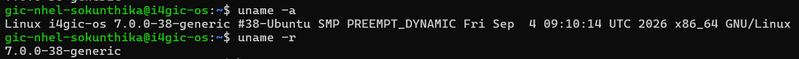
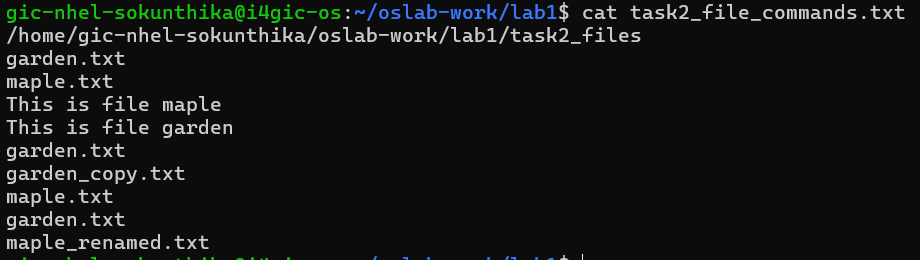
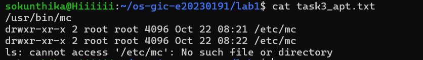
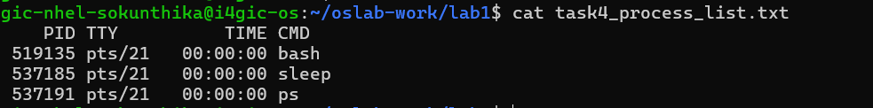
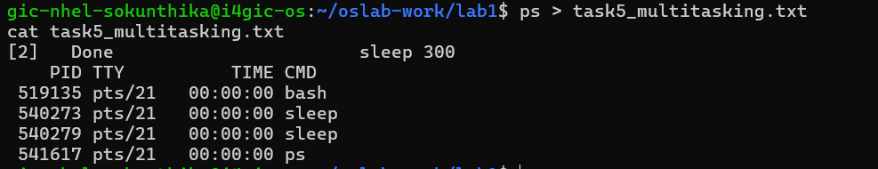
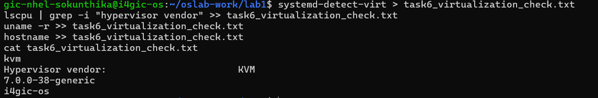

# OS Lab 1 Submission

- **Student Name:** NHEL SOKUNTHIKA
- **Student ID:** e20230191

---

## Task 1: Operating System Identification

- **OS Distribution:** Ubuntu 26.04.01 LTS
- **Kernel Version:** Linux 7.3.0-9-generic
- **Hostname:** sokunthika

Identified the system distribution and kernel release using `uname -a` and `lsb_release -a`.

---

## Task 2: Essential Linux File and Directory Commands

- Created and navigated directory `task2_files` using `mkdir` and `cd`.
- Created files `a.txt` and `b.txt` with `touch`, wrote text into them with `echo`, and viewed content using `cat`.
- Practiced file operations: duplicated `a.txt` with `cp`, renamed `b.txt` to `b_renamed.txt` using `mv`, and removed `a_copy.txt` using `rm`.

---

## Task 3: Package Management Using APT

- **`remove`:** Uninstalls package binaries but preserves configuration files (the directory `/etc/mc` still exists).
- **`purge`:** Completely deletes the package along with its configuration files (`/etc/mc` is deleted).

 

---

## Task 4: Programs vs Processes (Single Process)

- Executed `sleep 120 &` to run the program asynchronously as a background process.
- Verified that the program became an active process by viewing its Process ID (PID) in `ps`.

---

## Task 5: Installing Real Applications & Observing Multitasking

- Installed `htop` and `tmux` using `sudo apt-get install`.
- Spawned multiple concurrent background processes (`sleep` commands and `python3 -m http.server 8080`).
- Verified multitasking in `ps`, showing multiple independent processes executing concurrently under different PIDs.

---

## Task 6: Virtualization and Hypervisor Detection

- **Environment:** The operating system is running inside a **virtual machine**.
- `systemd-detect-virt` returned `kvm`.
- `lscpu` identified the hypervisor vendor as **KVM**.

