# Class Activity 1 — System Calls in Practice

- **Student Name:** Nhel Sokunthika
- **Student ID:** e20230191
- **Date:** 09/Nov/2026

---

## Warm-Up: Hello System Call

Screenshot of running `hello_syscall.c` on Linux:

Screenshot of running `copyfilesyscall.c` on Linux:

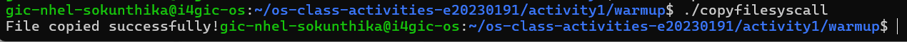

---

## Task 1: File Creator & Reader

### Part A — File Creator

**Describe your implementation:** 
I implemented two versions of the file creator program. The first version uses C library functions, while the second version uses POSIX system calls.

The library version uses fopen(), fprintf(), and fclose() to create and write content into a file. The system call version uses open(), write(), and close() to perform the same operations.

The main difference is that library functions provide a higher-level interface and handle some operations internally. System calls require me to manage the file descriptor, file permissions, and writing process more directly.

**Version A — Library Functions (`file_creator_lib.c`):**

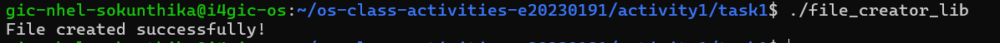

**Version B — POSIX System Calls (`file_creator_sys.c`):**

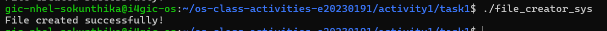

**Questions:**

1. **What flags did you pass to `open()`? What does each flag mean?**

I passed 3 flags to open(): 
- O_WRONLY: Opens the file for writing only.
- O_CREAT: Creates the file if it does not already exist.
- O_TRUNC: Removes the existing content if the file already exists.

These flags are combined using the bitwise OR operator (|).

2. **What is `0644`? What does each digit represent?**

0644 is an octal number representing file permissions in Linux.
Each digit represents permissions for a different group:

0: Special permission bits (none are enabled here).
6: Owner permissions (read and write).
4: Group permissions (read only).
4: Others' permissions (read only).

3. **What does `fopen("output.txt", "w")` do internally that you had to do manually?**

fopen() automatically handles several operations, such as opening or creating the file, truncating its previous content, and setting up a file stream with an internal buffer.
With system calls, I have to perform these operations manually using open(), write(), and close().

### Part B — File Reader & Display

**Describe your implementation:** 
I implemented two versions of a file reader program. The library version uses fopen(), fgets(), and fclose() to read and display the contents of a file. The system call version uses open(), read(), write(), and close(). It reads the file into a buffer and writes the contents to standard output. The library version is easier to implement because functions such as fgets() handle buffering and reading strings. However, the system call version requires more manual control over the buffer and the number of bytes read.

**Version A — Library Functions (`file_reader_lib.c`):**

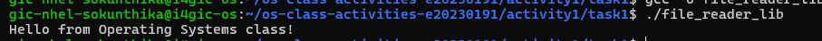

**Version B — POSIX System Calls (`file_reader_sys.c`):**

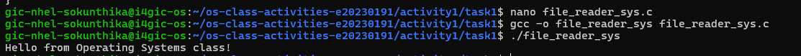

**Questions:**

1. **What does `read()` return? How is this different from `fgets()`?**

read() returns the number of bytes successfully read.
A positive number means the number of bytes read.
- 0 means the end of the file has been reached (EOF).
- -1 means an error occurred.
On the other hand, fgets() returns a pointer to the buffer when it successfully reads a string. It returns NULL when it reaches EOF or encounters an error. Therefore, read() works with bytes, while fgets() is designed to read strings.

2. **Why do you need a loop when using `read()`? When does it stop?**
A loop is needed because read() does not guarantee that it will read the entire file in one call. It may return fewer bytes than requested. The loop continues reading until read() returns 0, which indicates the end of the file. It should also stop if read() returns -1, indicating an error.

---

## Task 2: Directory Listing & File Info

**Describe your implementation:** 
I implemented two versions of a directory listing program. The library version uses functions such as opendir(), readdir(), and stat() to open a directory, retrieve its entries, and obtain information about files. The system call version uses lower-level operations to retrieve directory entries and file information. Both versions can display information such as file names, file sizes, and file types. However, the library version provides a simpler interface, while the system call version requires more manual handling of data structures and file information.

### Version A — Library Functions (`dir_list_lib.c`)

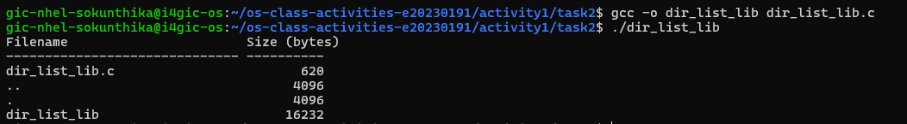

### Version B — System Calls (`dir_list_sys.c`)

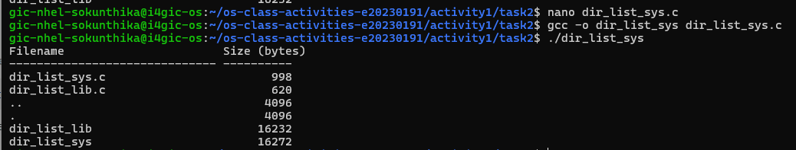

### Questions

1. **What struct does `readdir()` return? What fields does it contain?**
readdir() returns a pointer to a struct dirent, which represents an entry inside a directory. Some important fields include:
- d_name: The name of the file or directory.
- d_ino: The inode number.
- d_type: The type of the entry, such as a regular file or directory, when supported by the filesystem.
The structure allows the program to access information about directory entries.

2. **What information does `stat()` provide beyond file size?**
Besides file size, stat() provides several types of file information, including:
- File type (regular file, directory, symbolic link, etc.).
- File permissions.
- Owner user ID (UID).
- Owner group ID (GID).
- Inode number.
- Number of hard links.
- Last access time.
- Last modification time.
- Last status change time.
This information helps a program understand the properties and metadata of a file.

3. **Why can't you `write()` a number directly — why do you need `snprintf()` first?**
write() works with bytes, not integer values.
If I want to display a number, I must first convert it into a string using snprintf().
For example, snprintf() converts an integer into readable characters and stores them in a character buffer. Then, write() can send those characters to standard output.

---

## Task 3: strace Analysis

**Describe what you observed:** 
I used strace to observe the system calls made by the library version and the system call version. The library version uses higher-level functions such as fopen() and fprintf(). Although these functions make programming easier, they may perform additional operations internally, such as memory allocation, buffering, and file metadata checks. The system call version directly uses operations such as open(), write(), and close(). Therefore, its system call behavior is generally easier to understand and control.
One interesting observation is that a simple C library function may involve multiple system calls or other internal operations.

### strace Output — Library Version (File Creator)
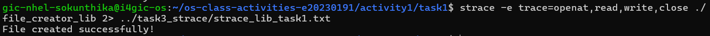

### strace Output — System Call Version (File Creator)
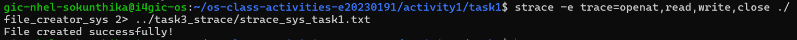

### strace Output — Library Version (File Reader or Dir Listing)
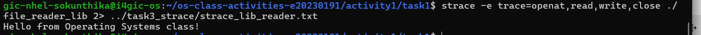

### strace Output — System Call Version (File Reader or Dir Listing)
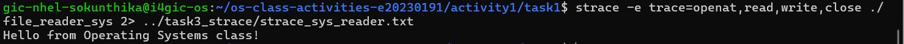

### strace -c Summary Comparison
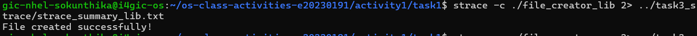
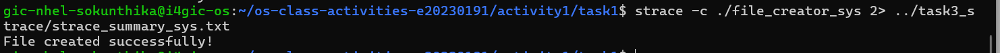

### Questions

1. **How many system calls does the library version make compared to the system call version?**
According to my strace -c results:
- Library version: [Insert your total system call count]
- System call version: [Insert your total system call count]
The library version made [Insert the difference] more system calls than the system call version.
This shows that library functions may involve additional internal operations beyond the main file operations.

2. **What extra system calls appear in the library version? What do they do?**
Some additional system calls that may appear include:
- brk(): Changes the size of the process's heap memory.
- mmap(): Maps files or memory into the process's address space.
- munmap(): Removes a memory mapping.
- fstat(): Retrieves information about an opened file.
- newfstatat(): Retrieves file information using a directory file descriptor and a pathname.
- close(): Closes an open file descriptor.
Some of these calls are related to memory management, file metadata, and program initialization rather than the actual file-writing operation.
The exact system calls depend on the program and its execution environment.

3. **How many `write()` calls does `fprintf()` actually produce?**
According to my strace output, the library version produced [Insert the actual number of write() calls] write() calls.
This happens because fprintf() uses an internal buffer. Instead of sending every character to the operating system immediately, it can collect the output and write it in larger blocks. The actual number of write() calls depends on buffering and when the buffer is flushed.

4. **In your own words, what is the real difference between a library function and a system call?**
A library function is a higher-level function that provides an easier way for programmers to perform operations. It may perform several internal operations and use system calls when it needs services from the operating system.
A system call is the interface that allows a user program to request services directly from the operating system kernel.
In simple terms, library functions make programming easier, while system calls provide access to operating system services.

---

## Task 4: Exploring OS Structure

### System Information
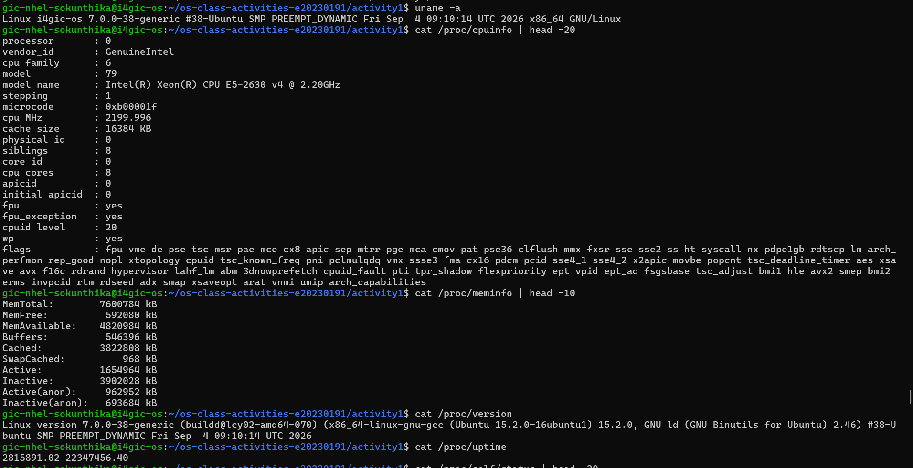

### Process Information
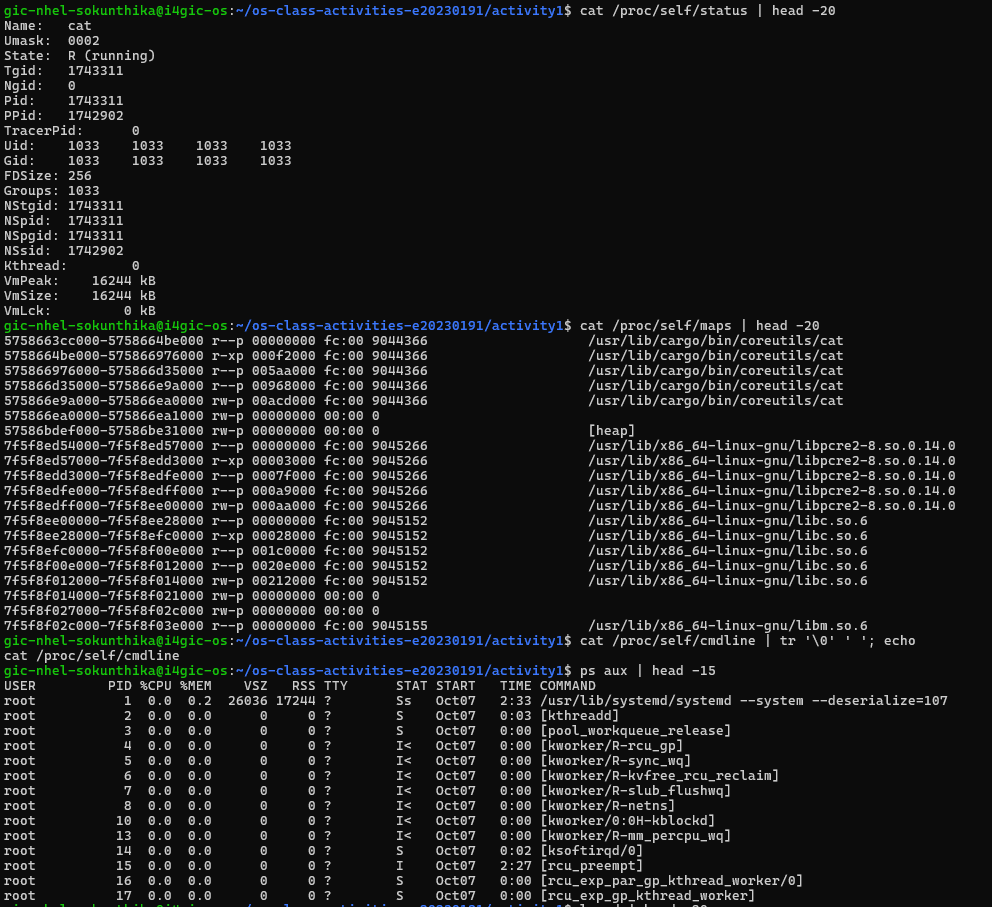

### Kernel Modules
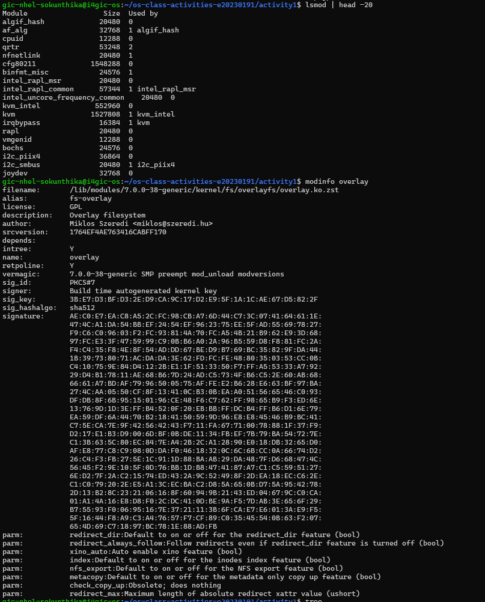

### OS Layers Diagram
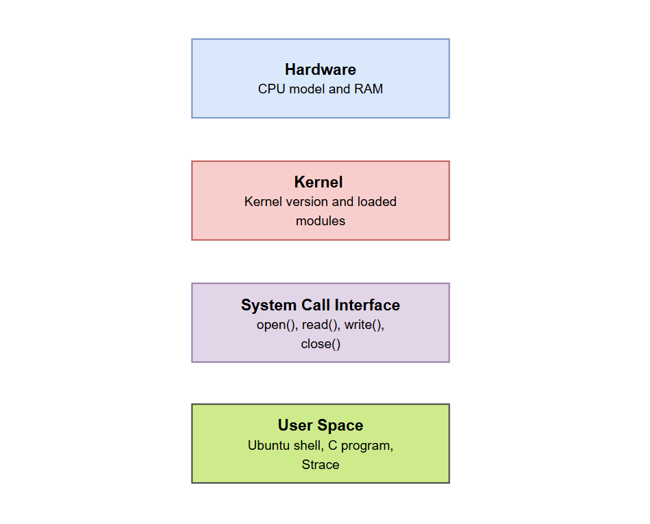

### Questions

1. **What is `/proc`? Is it a real filesystem on disk?**
/proc is a virtual filesystem in Linux that provides information about the running system and its processes. It is not a normal filesystem stored on a physical disk. Instead, its contents are generated dynamically by the Linux kernel.
For example, /proc/cpuinfo provides information about the CPU, while /proc/meminfo provides information about memory usage.

2. **Monolithic kernel vs. microkernel — which type does Linux use?**
Linux uses a monolithic kernel architecture.
This means that many operating system services, such as process management, memory management, device drivers, and filesystem management, operate within kernel space.
However, Linux also supports loadable kernel modules, which allow certain components, such as device drivers, to be loaded or unloaded when needed.

3. **What memory regions do you see in `/proc/self/maps`?**
/proc/self/maps displays the memory regions currently mapped into a process's virtual address space.
Common memory regions include:

- Executable code (text segment): Contains the program's instructions.
- Data segment: Stores initialized global and static variables.
- BSS segment: Stores uninitialized global and static variables.
- Heap: Used for dynamic memory allocation.
- Stack: Stores local variables, function parameters, and function call information.
- Shared libraries: Contains mapped libraries used by the program.
- Memory-mapped regions: Used for files or other memory mappings.
- VDSO and VVAR: Special memory regions provided by the kernel for certain operations.
- These regions help explain how Linux manages memory for running processes.

4. **Break down the kernel version string from `uname -a`.**
The kernel version string contains information about the Linux kernel and the system.
For example, it may contain:
- Linux: Operating system kernel name.
- Hostname: Name of the computer.
- Kernel release: Kernel version and additional release information.
- Kernel version: Build information, including the build number and date.
- Machine architecture: Hardware architecture, such as x86_64.
- Operating system: Usually GNU/Linux.

My actual kernel version is: Linux i4gic-os 7.0.0-38-generic #38-Ubuntu SMP PREEMPT_DYNAMIC Fri Sep  4 09:10:14 UTC 2026 x86_64 GNU/Linux

5. **How does `/proc` show that the OS is an intermediary between programs and hardware?**
The /proc filesystem demonstrates that the operating system acts as an intermediary between applications and hardware. Applications do not need to communicate with hardware directly. Instead, they request information and services through the operating system.
For example, /proc/cpuinfo provides CPU information, and /proc/meminfo provides memory information. The kernel collects and presents this information to user programs through the /proc filesystem.
This shows how the operating system manages hardware resources and provides a controlled interface for applications to access system information.

---

## Reflection
**What did you learn from this activity? What was the most surprising difference between library functions and system calls?**

Through this activity, I learned how programs interact with the operating system using library functions and system calls. I practiced creating, reading, and listing files using C programming and Linux commands. The most interesting part was using `strace` to compare both approaches. I learned that library functions may perform additional operations, such as buffering and memory management, before communicating with the kernel. I also explored the `/proc` filesystem to understand how Linux manages processes, memory, and hardware information. Overall, this activity helped me better understand how programs, the kernel, and hardware work together.

